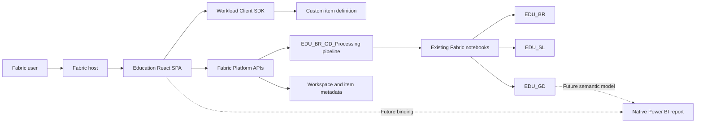

# Education Fabric Workload Specification

## Purpose

Define a Microsoft Fabric custom workload for Education Analytics using the Microsoft Fabric Extensibility Toolkit: a React and TypeScript single-page application hosted inside Fabric, with no custom application backend in the initial release.

The workload provides one recognizable home that deploys and manages the repository's Bronze, Silver and Gold Fabric artifacts. It stores package deployment state and artifact IDs in a custom Fabric item, shows status, invokes native Fabric jobs and exposes a future report extension point.

## Reference baseline

This specification is based on the official [`microsoft/fabric-extensibility-toolkit`](https://github.com/microsoft/fabric-extensibility-toolkit) repository, not the older `Microsoft-Fabric-workload-development-sample` repository.

| Reference | Pinned value |
| --- | --- |
| Toolkit repository | `microsoft/fabric-extensibility-toolkit` |
| Reviewed `main` commit | `dacab1b391d03010ba61a0446126d05515c487f0` |
| Latest reviewed release | `v2026.03` (`fbdc891e83d14fbfefd4f7e7e27194fd97f153ed`) |
| Workload client | `@ms-fabric/workload-client` `^3.1.1` in the reviewed toolkit |
| UI stack | React 18, TypeScript, Fluent UI v9, React Router |
| Manifest schema | `2.0.0` |
| Review date | 2026-09-17 |

Microsoft describes this toolkit as an evolution of the Workload Development Kit and recommends it for new projects. The reviewed release includes optional remote backend and custom-item job infrastructure, but neither is required by this design.

Before implementation, update the pin deliberately, review release notes and rerun the architecture and security checks in this document. Do not silently build from a moving `main` branch.

### Nonprofit Data Solutions concept review

The Microsoft [Nonprofit Data Solutions Fabric workload](https://github.com/microsoft/Nonprofits/tree/master/NonprofitDataSolutions/FabricWorkload) was reviewed at commit `8dfaa4ce824d6a0e8ed4dd5f0a9ddbcb131e7bad`.

NDS is a useful example, not a source of truth, and this specification does not adopt its code. The concepts worth carrying forward are:

- one domain solution item as the user's durable entry point;
- a guided first-run experience followed by a quieter operational home;
- clear deployment or refresh status with actionable next steps;
- direct navigation to native Fabric artifacts;
- compact Fluent UI composition with skeleton, empty, success and error states; and
- separation between routed views and reusable components.

NDS demonstrates package deployment, but this baseline uses one fixed Education package rather than a generic registry, selectable modules, strategy factory or post-deploy framework.

## Decision summary

1. Build one custom workload named `Org.EducationAnalytics` for tenant-local development. Register a publisher-qualified name before cross-tenant publication.
2. Contribute one custom item type named `EducationSolution`.
3. Implement the item as a React/TypeScript SPA under `Workload/`.
4. Use workload manifest hosting type `FERemote` with one `Frontend` service endpoint and `EnableSandboxRelaxation=false`.
5. Do not deploy a custom REST API, token-exchange service, database or custom-item job backend for the MVP.
6. Persist item configuration through `WorkloadClientAPI.itemCrud` as a versioned `payload.json` item-definition part.
7. Use delegated user tokens for Fabric APIs. Never place client secrets, service-principal credentials or data credentials in the SPA or item definition.
8. Reuse `EDU_BR`, `EDU_SL`, `EDU_GD`, the seven notebooks and the `EDU_BR_GD_Processing` pipeline defined by this repository.
9. Make package deployment the primary workflow: create missing artifacts, update managed definitions and reuse existing Lakehouses.
10. Do not require Power BI for the initial workload. Add optional governed reporting bindings when those artifacts are delivered.
11. Keep all five use cases deterministic and usable without AI. AI remains a later, separately authorized capability.
12. Keep the implementation specific and small. Do not introduce a generic package framework before a second real solution requires one.

## Scope

### In scope

- Guided deployment or adoption of the Education Fabric artifact package.
- Idempotent creation of three Lakehouses, seven notebooks and one Data Pipeline.
- Managed notebook and pipeline definition updates with dependency-ID substitution.
- Artifact readiness and job-status visibility.
- A clear future-ready state for the five education reporting experiences.
- On-demand execution and monitoring of the existing enrichment pipeline for authorized operators.
- Navigation to related native Fabric items and Power BI content when configured.
- Responsive, accessible Fabric-native UI using Fluent UI v9.

### Out of scope

- A custom application backend.
- Reimplementation of ingestion or transformation logic in TypeScript.
- Direct browser parsing of Delta or Parquet files from OneLake.
- Browser-held secrets or application-only credentials.
- Client-side filters as an authorization control.
- Custom job execution for the `EducationSolution` item itself.
- Generic multi-package registries, selectable modules or third-party package ingestion.
- Bronze sample CSV upload through the browser; the existing installer remains available for fixtures.
- Custom React dashboards or direct Gold record queries.
- Curriculum alignment, skill diagnosis, content recommendation or delivery.
- Assessment growth, proficiency, intervention effectiveness or school ranking.
- Automatic student risk classifications or writeback to source systems.
- AI-generated facts, metrics, DAX or SQL.

## Architecture



  The SPA is a solution home, status surface and launcher. Fabric remains the identity, data, processing, security and analytics plane.

### Backend-free boundary

The MVP is backend-free when all of these conditions hold:

- Interactive operations run in the signed-in user's delegated identity.
- Item configuration fits in the custom Fabric item definition.
- The SPA does not read education records; future analytics use a governed semantic model and native Power BI report.
- Long-running data processing is performed by native notebooks and pipelines.
- No secrets or privileged application-only operations are required.

A backend becomes necessary only for an approved requirement such as service-principal-only automation, secret-bearing third-party calls, webhook receipt, privileged cross-tenant operations or durable server-side AI orchestration. Adding one is an architecture change, not a default toolkit step.

## Workload structure

Create the workload from the pinned toolkit and retain its established layout:

```text
Workload/
├── .env.dev
├── .env.test
├── .env.prod
├── package.json
├── app/
│   ├── App.tsx
│   ├── components/
│   │   ├── ArtifactLink.tsx
│   │   ├── StatusRow.tsx
│   │   └── StateMessage.tsx
│   ├── items/
│   │   └── EducationSolutionItem/
│   │       ├── EducationSolutionItemDefinition.ts
│   │       ├── EducationSolutionItemEditor.tsx
│   │       ├── EducationSolutionItemRibbon.tsx
│   │       ├── SetupWizard.tsx
│   │       └── views/
│   │           ├── OverviewView.tsx
│   │           ├── DataView.tsx
│   │           └── ReportsView.tsx
│   └── services/
│       └── fabricService.ts
└── Manifest/
    ├── Product.json
    ├── WorkloadManifest.xml
    ├── assets/
    └── items/
        └── EducationSolutionItem/
            ├── EducationSolutionItem.json
            └── EducationSolutionItem.xml
```

Use the toolkit's mandatory `ItemEditor` component and its registered-view pattern. Retain the standard ribbon, notifications, settings, navigation and item lifecycle controllers. Prefer Fluent UI v9 components; use v8 only where the toolkit has no v9 replacement.

Do not add a generic package registry, strategy factory, module framework, global state library or custom design system. Local React state and one item-level context are sufficient until measured complexity proves otherwise.

### Partner extension surface

A Microsoft partner should need to change only a small, documented surface:

| Area | Partner changes |
| --- | --- |
| Identity | Workload name, item name, publisher and Entra app |
| Brand | Icons, screenshots, product copy and support links |
| Artifact contract | Expected Fabric item names, types and stored IDs |
| Home | Status rows and native Fabric destinations |
| Reports | Audience labels, report ID and report-page links |
| Security | Semantic-model roles and organizational mappings |

Provide an environment example with placeholders and a short partner guide. A partner must not need to understand Education-specific notebooks or a generic deployment engine before rendering and saving its first custom item.

## Manifest contract

### Workload manifest

`WorkloadManifest.xml` must declare:

- `SchemaVersion="2.0.0"`.
- `WorkloadName="{{WORKLOAD_NAME}}"`.
- `HostingType="FERemote"`.
- Semantic `{{WORKLOAD_VERSION}}`.
- Public cloud unless another Fabric cloud is explicitly targeted.
- `AADFEApp/AppId={{FRONTEND_APPID}}`.
- One `ServiceEndpoint` named `Frontend` at `{{FRONTEND_URL}}`.
- `IsEndpointResolutionService=false`.
- `EnableSandboxRelaxation=false` unless a reviewed browser capability proves it necessary.

The production frontend URL must use HTTPS and meet Fabric publishing-domain requirements. Development may use the toolkit's local server and DevGateway.

### Product manifest

`Product.json` must:

- Present the product as **Education Analytics**.
- Recommend only the `EducationSolution` item type.
- Add one create card for an Education solution.
- Use genuine workload icons and screenshots, not reused HelloWorld assets.
- List only real support, privacy, terms and documentation URLs before publication.
- Declare compatible Fabric item types only when the SPA implements the corresponding integration.
- Omit custom workload job types from the MVP.

### Item manifests

Use `EducationSolutionItem.xml` to declare `{{WORKLOAD_NAME}}.EducationSolution`. Use `EducationSolutionItem.json` to register the editor route and Fabric lifecycle actions. Keep the unqualified item name and manifest filenames within Fabric's 32-character limit.

Recommended route:

```text
/EducationSolutionItem-editor/:itemObjectId
```

Also provide item settings and about routes through the toolkit's standard settings controller.

## Item definition

Persist configuration in the custom item's `payload.json` definition part by using the toolkit's `getWorkloadItem` and `saveWorkloadItem` wrappers. Fabric owns item creation and metadata; the SPA owns this payload schema.

```typescript
export interface EducationSolutionItemDefinition {
  schemaVersion: 1;
  binding: {
    workspaceId: string;
    bronzeLakehouseId?: string;
    silverLakehouseId: string;
    goldLakehouseId: string;
    processingPipelineId: string;
    semanticModelId?: string;
    reportId?: string;
  };
}
```

Rules:

- Store immutable Fabric item IDs after setup; keep display names only as cached labels.
- Validate that every bound item belongs to the bound workspace and has the expected Fabric type.
- Reject unknown future `schemaVersion` values rather than guessing a migration.
- Use optimistic dirty-state handling and explicit Save. Do not mutate the loaded definition before a successful save.
- Never store access tokens, secrets, connection strings, user-role assignments or student data in the definition.
- Do not store reporting results in the definition.
- Treat item-definition access as configuration access, not education-data authorization.

## Fabric API and authentication contract

Create the platform client from the `WorkloadClientAPI` supplied by Fabric. Acquire tokens on demand and in the signed-in user's context. Do not use the toolkit's service-principal helper in browser production code because a client secret cannot be protected in a SPA.

Request scopes progressively:

| Capability | Delegated scope |
| --- | --- |
| Discover workspace context | `Workspace.Read.All` |
| Read item metadata | `Item.Read.All` |
| Save custom item definition | `Item.ReadWrite.All` through workload item CRUD |
| Run the native enrichment pipeline | Prefer the narrow supported item-type execute scope; otherwise `Item.Execute.All` |

The Entra registration must be configured as a SPA with the Fabric workload sign-in redirect URI. Production uses authorization code with PKCE and delegated permissions. Consent and redirect URIs are environment-specific deployment inputs.

The UI must distinguish:

- authentication failure;
- missing OAuth consent;
- missing Fabric workspace role;
- missing item permission;
- report authorization failure; and
- transient or throttled API failure.

Do not log tokens, education records or full item definitions.

## Future native analytics boundary

The baseline SPA does not query Gold records and does not require Power BI. It stores optional semantic-model and report IDs so those assets can be attached later without redesigning the item.

This resolves the earlier GraphQL question for the MVP: there is no GraphQL item, client, schema-generation step or direct-record authorization path to build. Power BI owns analytical rendering, filtering and row-level security. GraphQL may be reconsidered only for a proven interaction that native reports cannot serve.

The Reports view contains compact destinations rather than embedded dashboards:

| Audience | Destination |
| --- | --- |
| Teacher | Class review; student attendance and recorded work |
| Head of school | Attendance and records briefing; assignment schedules |
| Head of district | Cross-school attendance briefing |

Until the semantic model and report are deployed, Reports shows **Coming later** without blocking setup or operations. It must not fall back to downloading OneLake files or enforcing organizational filters in React.

## Native job orchestration

The workload may run `EDU_BR_GD_Processing` through Fabric's Job Scheduler API. The pipeline executes all notebook stages in strict success order; the SPA must not copy transformation logic.

1. Verify the configured item type and current user's execute permission.
2. Submit the native item job using the job type supported by the deployed pipeline.
3. Read the job instance ID from the `Location` response header.
4. Respect `Retry-After` and poll the exact job instance to a terminal state.
5. Treat failed, cancelled and timed-out states as failures.
6. Refresh artifact and job status after success.
7. Prevent accidental duplicate submissions while a run is active.
8. Show the Fabric job ID and start/end timestamps for operator diagnosis.

The reviewed toolkit's `JobSchedulerClient` still uses the older query-parameter route in one helper, while current Fabric documentation uses `/jobs/{jobType}/instances` and retains the query form only for backward compatibility. Implement the current path and cover it with an integration test.

Reporting-period changes are operational inputs, not ordinary viewer filters. If the deployed pipeline cannot safely accept supported per-run parameters, direct operators to the repository installer/configuration flow instead of editing notebook definitions from the browser.

## User experience

The first screen is the working item editor, not a marketing landing page. Use the NDS lifecycle concept in a smaller form: focused first-run setup, then a restrained operational home.

### Three-step setup

| Step | User action | Validation |
| --- | --- | --- |
| Workspace | Confirm the current workspace | Workspace is accessible and supported |
| Solution | Auto-detect or select the Education Lakehouses and enrichment pipeline; optionally attach future reporting assets | IDs, names and Fabric item types match |
| Review | Review bindings and save | All required artifacts belong to the selected workspace; no secret or education record is stored |

The finish state lists created, updated and reused artifacts. **Deploy package** is the primary action. **Use existing artifacts** adopts a compatible installation without rewriting it.

### Views

Use only three left-navigation destinations:

| View | Content and actions |
| --- | --- | --- |
| Overview | Solution readiness, latest enrichment job and concise next action |
| Data | Bronze/Silver/Gold status, latest pipeline run, **Run enrichment** and native artifact links |
| Reports | Future reporting state; opens the native report only when configured |

Settings remains a ribbon action rather than another navigation destination.

### Ribbon

The Home tab contains Save and Settings using toolkit action factories. Contextual actions may include Refresh, Run enrichment and Open in Fabric. Disable actions while loading or running, and provide accessible tooltips and status announcements.

### Visual direction

- Use a neutral Fabric canvas with one white working surface, compact spacing and stable dimensions.
- Use one clear page heading and modest section headings; avoid hero-scale typography.
- Prefer status rows, key-value lists and tables over decorative card grids.
- Use color only for status, never to rank schools or students.
- Use Fluent icons, tooltips and accessible names for actions.
- Use skeleton loading, message bars and explicit empty states.
- Keep the UI usable with keyboard navigation, screen readers, 200% zoom and narrow Fabric panes.

These are conceptual lessons from NDS's compact ribbon, explorer, status feedback and next-action treatment. Education branding, content and composition remain original.

### Required labels

- Work data: **Provided source snapshot; observation time unavailable**.
- Null assignment due date: **Undated**, never overdue.
- Assessment count: **Administrations**, never learners.
- Attendance: show rate and coverage together, including present, known and expected denominators.
- District comparison: neutral ordering and language; no ranking or performance color scale.

## Reporting rules

When introduced, the semantic model and report must preserve the definitions in the implementation plan and Gold specification:

- Attendance rate is `sum(present_days) / sum(known_days)`.
- Attendance coverage is `sum(known_days) / sum(expected_days)`.
- Unknown attendance is not absent; excused absence is not present.
- Cohort size is a distinct learner count over eligible rows.
- Period comparisons use equal-length periods, identical scope and ratios of sums.
- Assignment dates are recorded base due dates; learner overrides are unavailable.
- Submission states are native source states.
- Assessment records show label, subject, date, window, RIT and standard error; no growth or proficiency is inferred.
- District output is independently aggregated and has no student, class or teacher drill path.

The SPA does not recompute these metrics.

## Security and privacy

The workload follows least privilege and defense in depth:

1. The SPA never reads education records. Future semantic models and Power BI reports enforce access before data is shown.
2. Teacher access is restricted to assigned sections and effective membership.
3. School leaders are restricted to their school scope.
4. District leaders receive only approved aggregate objects.
5. District cells below the approved disclosure threshold are suppressed server-side.
6. Export, copy and drill actions follow the same server-side scope and are disabled where disclosure review requires it.
7. The browser holds tokens only in memory through the supported authentication flow.
8. Telemetry uses operation IDs, timings, status and coarse view names; it excludes names, institutional IDs, grades and attendance records.
9. Content Security Policy permits only the Fabric host, deployed frontend, required Microsoft identity endpoints and Fabric APIs.
10. Dependency scanning, lockfile review and manifest validation are release gates.

The absence of an access-policy table never grants access. Hiding a route, tab, button or field in React is not authorization.

## Failure states

Each view must provide an actionable state for:

- unconfigured item;
- deleted or moved bound artifact;
- wrong item type;
- permission denied;
- empty authorized scope;
- report not configured;
- throttling with retry guidance;
- pipeline already running;
- pipeline failure, cancellation or timeout; and
- unsupported item-definition version.

Never replace an authorization failure with an empty-data success state.

## Development and deployment

### Local development

1. Fork or vendor the pinned toolkit into a dedicated workload source directory.
2. Run `scripts/Setup/Setup.ps1 -WorkloadName "Org.EducationAnalytics"`.
3. Configure `.env.dev` with the development workspace, workload name, frontend app ID and local frontend URL.
4. Install `Workload` dependencies with the committed lockfile.
5. Run `scripts/Run/StartDevGateway.ps1` and `scripts/Run/StartDevServer.ps1`.
6. Open the workload through the Fabric developer experience and create an `EducationSolution` item.

Do not commit generated `build/`, `release/`, environment secrets or developer tokens.

### Build and release

Use the toolkit scripts to:

1. Validate XML manifests against their XSDs.
2. Build the environment-specific manifest package.
3. Compile the production SPA into static frontend assets.
4. Produce `release/<manifest-package>.nupkg` and `release/app/`.
5. Deploy the static SPA to an approved HTTPS host, initially Azure Web App static hosting or an equivalent reviewed host.
6. Upload the manifest package through Fabric workload management. The reviewed toolkit does not automate this final upload.

Promote immutable frontend builds and manifest versions through dev, test and production. Environment files may contain IDs and URLs but no secrets.

### Existing solution installer

The workload is the primary artifact deployment experience. `Install-IntoWorkspace.ps1` remains an operator fallback and supplies the large synthetic Bronze CSV package, which is deliberately not bundled into the SPA.

On rerun, the workload reuses same-name Lakehouses, updates all six managed notebook definitions and the managed pipeline, and fails before mutation when a same-name artifact has the wrong Fabric type.

## Testing strategy

### Unit tests

- Item-definition validation and migration.
- Dirty state and save success/failure behavior.
- Scope-aware route availability.
- Native artifact-link generation.
- Job-state transitions and `Retry-After` handling.
- Error classification with no sensitive logging.

### Contract tests

- Future semantic model and report definitions preserve the approved Gold contract.
- Manifest XML and JSON pass toolkit validation.
- Production build contains no source maps unless explicitly approved.
- No secrets or tenant data are present in static assets.

### Integration tests

- Create, load, edit and save an `EducationSolution` item.
- Acquire each delegated token with the minimum requested scopes.
- Discover and validate every bound Fabric artifact.
- When configured, open the report under allowed and denied identities.
- Run and monitor the real enrichment pipeline through the current Job Scheduler route.
- Verify expired token, 401, 403, 404, 429 and long-running-operation behavior.

### End-to-end and accessibility tests

- Execute all five use cases in Fabric at desktop and narrow viewport sizes.
- Verify keyboard navigation, focus order, screen-reader labels, contrast and zoom.
- Verify that loading, empty, stale and error states do not shift or overlap the layout.
- When reporting is configured, assert that teacher, school and district identities cannot cross their report and semantic-model boundaries.
- Verify district suppression and absence of identifying export/drill paths.

## Delivery phases

### Phase 0: shell

- Create the workload from the pinned toolkit.
- Prove item create/load/save with `payload.json`.
- Prove delegated Fabric item discovery and pipeline job submission.

### Phase 1: deployment and operations

- Implement the three-step deployment/adoption wizard and three steady-state views.
- Show artifact readiness and job status.
- Add safe on-demand enrichment for authorized operators.

### Phase 2: optional native reports

- Bind the governed semantic model and report.
- Validate the five report destinations and teacher, school and district roles.

### Phase 3: release hardening

- Complete accessibility, localization, telemetry, support and privacy artifacts.
- Add CI build, manifest, dependency, contract and browser tests.
- Promote through isolated dev, test and production configurations.

### Phase 4: optional AI

Consider AI only through a separate security and architecture decision. It must receive already authorized, bounded evidence; cite records and filters; abstain when evidence is insufficient; and require human review. A secret-bearing Azure OpenAI call is not made directly from this SPA.

## Acceptance criteria

The MVP is complete when:

1. The workload runs as a React SPA with no custom application backend.
2. Fabric can create, open, save and reopen an `EducationSolution` item.
3. The item deploys three Lakehouses, seven notebooks and one pipeline in dependency order.
4. Reruns reuse Lakehouses and update managed definitions without duplicate artifacts.
5. The item definition contains deployment bindings only and no secret or student record.
6. The three SPA views remain Overview, Data and Reports; Reports works as a future-ready state before Power BI exists.
7. Data authorization is enforced and penetration-tested outside React.
8. District users cannot retrieve identifying records through UI or direct API calls.
9. An authorized operator can start and monitor the native enrichment pipeline without duplicate submissions.
10. The workload never claims Power BI is available until both optional reporting artifacts are bound.
11. Manifest validation, TypeScript checks, unit tests, integration tests, accessibility tests and production build pass.
12. Production deployment uses HTTPS, approved domains, least-privilege delegated scopes and an immutable version.
13. The experience remains fully useful with AI disabled.
14. Lockfile-backed installation, TypeScript checks, frontend build, XSD manifest validation, NuGet packaging and PowerShell parsing pass; CI uses `npm ci`.
15. The dependency audit has no high or critical advisories; residual upstream advisories are documented.

## Open decisions

These decisions require environment evidence before release:

- The semantic model and report artifact names and IDs.
- The exact semantic-model role mapping for teacher, school and district users.
- The exact native job type exposed by the deployed enrichment pipeline.
- The approved minimum district cell size and export policy.
- The production publisher identity, workload name and verified hosting domain.

## References

- [Microsoft Fabric Extensibility Toolkit](https://github.com/microsoft/fabric-extensibility-toolkit)
- [Fabric Extensibility Toolkit documentation](https://learn.microsoft.com/fabric/extensibility-toolkit/)
- [Workload manifest](https://learn.microsoft.com/fabric/extensibility-toolkit/manifest-workload)
- [Item manifest](https://learn.microsoft.com/fabric/extensibility-toolkit/manifest-item)
- [Fabric REST API - Run on-demand item job](https://learn.microsoft.com/rest/api/fabric/core/job-scheduler/run-on-demand-item-job)
- [Microsoft Nonprofit Data Solutions Fabric workload](https://github.com/microsoft/Nonprofits/tree/master/NonprofitDataSolutions/FabricWorkload)
- [Use cases](../use-cases/README.md)
- [Gold data model specification](Gold%20Data%20Model%20Creation.md)
- [Installation guide](../../deploy/README.md)